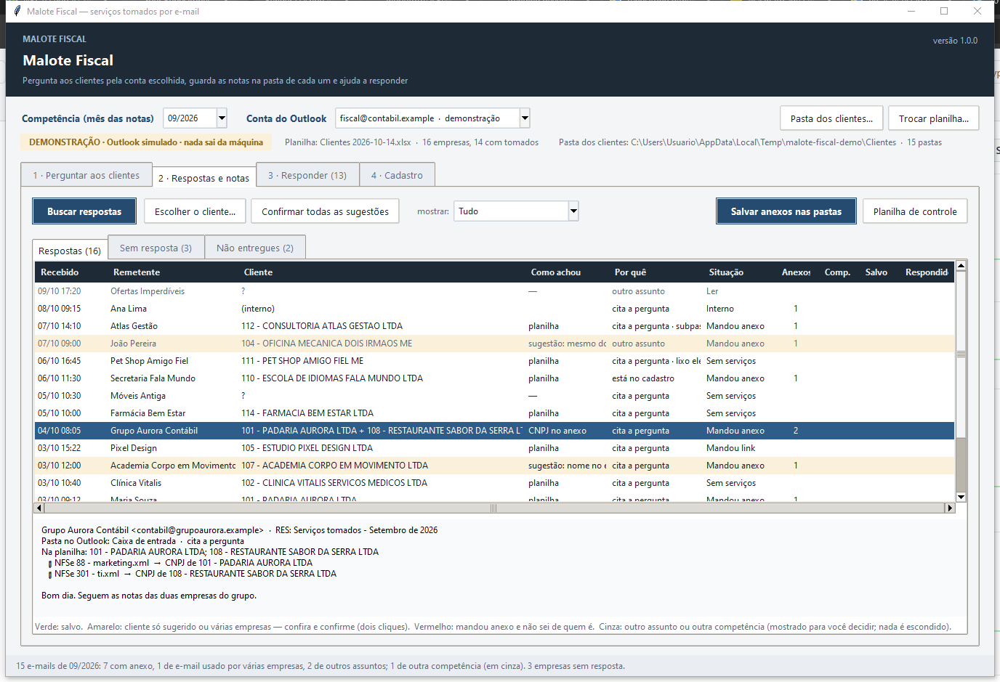
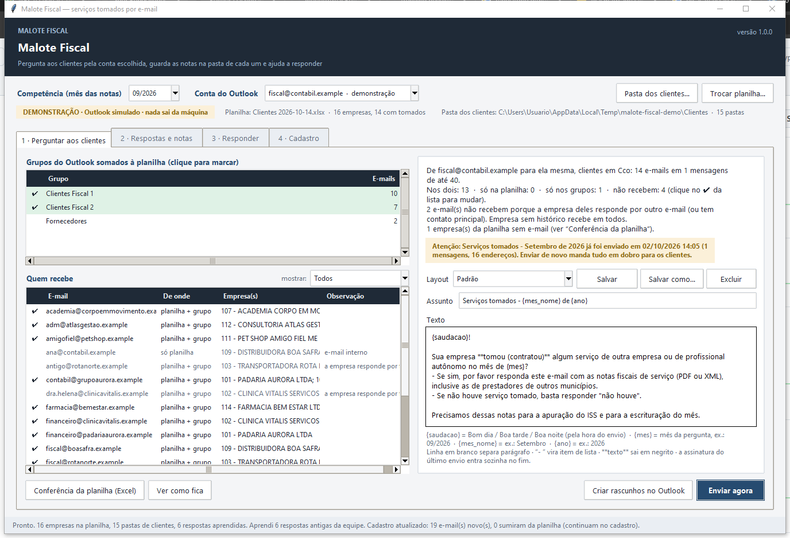
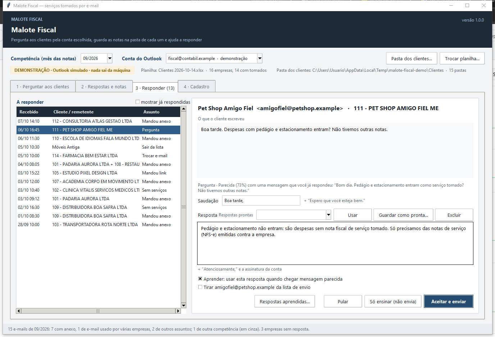
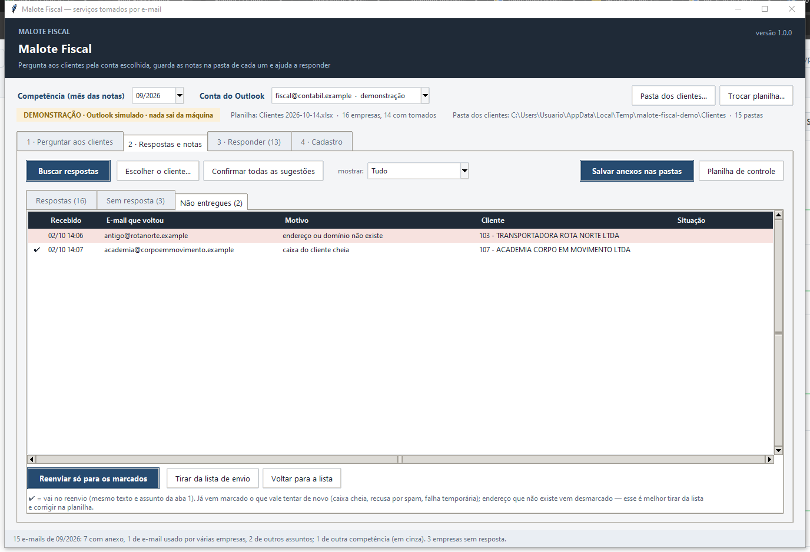
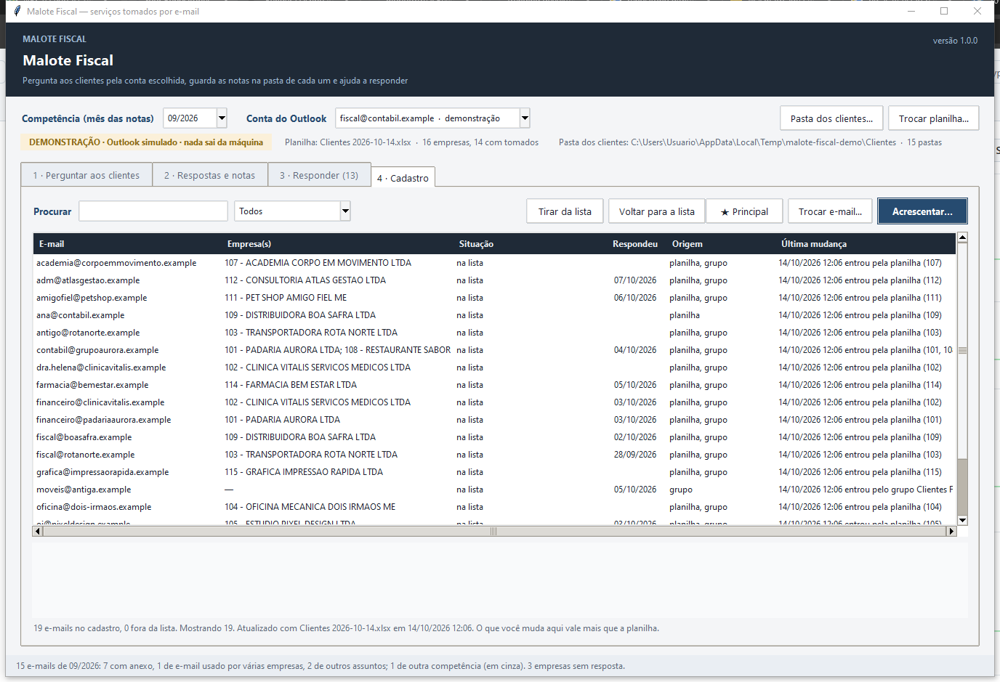

# Malote Fiscal

[](https://github.com/DiogusVincere/malote-fiscal/actions/workflows/testes.yml)

Pergunta aos clientes de um escritório contábil, pelo Outlook, se **tomaram serviços** no mês; lê **todas** as
respostas, inclusive as que não parecem resposta; guarda as notas na pasta de cada cliente; e ajuda a responder,
aprendendo com o que a equipe já escreveu. Sem servidor, sem senha, sem IA de fora: roda ao lado do Outlook da máquina.

Versão pública de uma ferramenta usada em produção num escritório contábil, com nomes, e-mails, pastas e textos
trocados por um escritório fictício. Tem um **modo demonstração** (`--demo`) que não precisa de Outlook e um
executável para Windows na aba Releases.



## O problema

Todo começo de mês, o fiscal precisa saber de cada cliente se ele **tomou (contratou) serviços** no mês anterior: as
NFS-e desses serviços entram na apuração do ISS e na escrituração. O jeito manual é um e-mail em massa pela conta do
departamento e, depois, dias lendo respostas, baixando anexo por anexo, descobrindo de qual empresa é cada e-mail (o
contador de um grupo manda as notas de três empresas de uma vez), salvando na pasta certa da rede e respondendo um a um.

O que mais custa é a resposta que **não parece resposta**: e-mail novo com assunto próprio, cliente que manda a nota
antes de ser perguntado, mensagem que cai numa subpasta ou no lixo eletrônico. Um filtro por assunto deixa isso passar,
e a nota só aparece quando a fiscalização pergunta por ela.

## O que a ferramenta faz

| Aba | O que acontece | Como |
|---|---|---|
| **1 · Perguntar** | Monta a lista de quem recebe e manda o e-mail do mês pela conta escolhida, em Cco, em lotes de 40 | Planilha de clientes **+** grupos de contatos do Outlook **+** cadastro próprio; empresa com vários e-mails recebe só em quem costuma responder (ou no contato principal); e-mail da equipe, ex-cliente e regime isento ficam de fora, com o motivo na tela; o texto é o do último envio (editável, com layouts salvos e campos `{saudacao}`, `{mes}`, `{mes_nome}`, `{ano}`); avisa se o mês já foi enviado |
| **2 · Respostas e notas** | Lê tudo o que chegou de fora para a competência e diz **por que** cada e-mail entrou | Caixa de entrada, subpastas e lixo eletrônico, desde o 1º dia do mês da competência; `cita a pergunta` / `está no cadastro` / `outro assunto`; competência pelo assunto, pelo nome do anexo ou pela data; identifica o cliente pela planilha, pelo que você já confirmou, pelo domínio, pelo nome; e-mail de várias empresas é resolvido pelo **CNPJ dentro do anexo** (PDF, XML ou ZIP); salva em `<cliente>\NFE\<ano>\<mês>\Tomados\Tomados e-mail` sem sobrescrever nada; avisos de "não entregue" ligados ao envio, com reenvio só para quem vale a pena |
| **3 · Responder** | Sugere a resposta para cada cliente; você corrige, aceita e ela aprende | Regras para o comum (anexo, link, "não houve", pedido para sair, troca de e-mail) e exemplos parecidos (TF-IDF por radical) aprendidos das respostas que a equipe já mandou; pedido de troca de e-mail ou de saída vira mudança pronta no cadastro, aplicada só quando você aceita |
| **4 · Cadastro** | Quem recebe e de qual empresa é cada e-mail | A planilha e os grupos atualizam o cadastro a cada abertura; o que você muda à mão vale mais; histórico por e-mail; contato ★ principal; e-mails que sumiram da planilha são sinalizados, nunca apagados |

## Decisões de projeto

- **Nada é escondido.** Antes, só entrava e-mail com "tomados" no assunto ou com a frase da pergunta citada no
  corpo; qualquer mudança no texto da pergunta fazia respostas sumirem. Agora toda mensagem de fora entra, marcada com
  a relação dela com a pergunta, e o que é de outro assunto ou de outra competência aparece em cinza para a pessoa
  decidir. Do lixo eletrônico só entra o que é resposta ou de contato conhecido.
- **Janela de leitura com uma regra, não com um palpite.** Lê desde o 1º dia do mês da competência; o que chegou
  antes do envio (ou do 1º dia do mês seguinte) só entra se citar a competência no assunto ou no nome do anexo. É assim
  que o cliente que manda a nota antes de ser perguntado aparece e as respostas do mês anterior não vêm junto.
- **Supervisionado, não automático.** A ferramenta sugere cliente, competência, resposta e mudança de cadastro; salva
  sozinha só o que a planilha ou você confirmaram. Toda resposta passa pelo seu olho antes de sair.
- **A lógica de leitura não toca no Outlook.** `ler_item`, `selecionar_respostas`, `atribuir_competencia` e
  `gravar_na_pasta` recebem dados simples e são as mesmas para o Outlook de verdade e para o simulado. É isso que deixa
  os testes rodarem em Linux, sem COM.
- **Nunca sobrescreve.** Arquivo igual (byte a byte) já na pasta vira "já estava"; nome repetido com conteúdo
  diferente ganha " (2)". Pastas de mês com grafias diferentes (`09-2026`, `09.2026`, `092026`) são reaproveitadas.

## Demonstração

```
pip install -r requirements.txt
python malote.pyw --demo       # a tela, sobre um Outlook simulado (Windows, Linux, macOS)
python -m malote.demo          # o fluxo inteiro no terminal, sem Tkinter
```

A demonstração monta um escritório fictício em `%TEMP%\malote-fiscal-demo`: catorze clientes com pastas na rede, a
planilha de clientes, três meses de perguntas já enviadas, respostas antigas da equipe (para a aba 3 aprender) e uma
caixa de entrada com os casos que a leitura precisa tratar: nota em PDF, "não houve", link para baixar, um e-mail
compartilhado por duas empresas com uma nota XML de cada, cliente que respondeu antes da pergunta, cliente que mandou
e-mail novo com assunto próprio, dúvida em vez de nota, remetente só reconhecível pelo nome, resposta na subpasta, resposta
no lixo eletrônico, spam no lixo, pedido para trocar e-mail, pedido para sair da lista, e-mail interno da equipe e dois
avisos de "não entregue" (endereço inexistente × caixa cheia). Tudo em domínios `.example`, que não existem. A
demonstração recomeça do zero a cada abertura; "Enviar" e "Responder" só mexem no Outlook simulado.

Na tela, a mesma entrada "demonstração" aparece na lista de contas do Outlook, então dá para alternar entre a conta real
e a simulada sem fechar nada.

| 1 · Perguntar | 3 · Responder |
|---|---|
|  |  |

| 2 · Não entregues | 4 · Cadastro |
|---|---|
|  |  |

## Usar de verdade

**Precisa de:** Windows, Outlook (desktop) com a conta configurada, e Python 3.12+ com as bibliotecas do
`requirements.txt` — ou o pacote portátil da aba **Releases**, que já traz tudo (`Malote Fiscal.exe`; na primeira vez o
SmartScreen avisa que o editor é desconhecido: "Mais informações" → "Executar assim mesmo").

```
python malote.pyw
```

1. **Conta do Outlook**, no alto da tela: a lista traz as contas configuradas na máquina. Tudo é relativo a ela: a Caixa
   de entrada que se lê, os Itens Enviados de onde sai o modelo do texto e o domínio que define o que é "e-mail interno".
2. **Pasta dos clientes**: a pasta onde cada cliente tem a sua subpasta `<código> - <nome>`. É lá que as notas são salvas.
3. **Planilha de clientes** (`Clientes AAAA-MM-DD.xlsx`, procurada em Downloads; a mais nova vale): colunas **Código,
   Razão Social, CNPJ/CPF, E-mails, Regime municipal, Resp. fiscal** e, opcionalmente, **Ex-cliente**. A ordem não importa;
   vários e-mails na mesma célula podem vir separados por `|`, `;` ou vírgula. É o formato que os sistemas de gestão de
   escritório costumam exportar.

Na primeira vez, se a conta nunca mandou a pergunta, o texto da aba 1 é o padrão da ferramenta; depois, é sempre o do
último envio feito pela conta (mudou no Outlook, mudou aqui). Configuração, cadastro, respostas aprendidas e planilhas de
controle ficam em `%LOCALAPPDATA%\Malote Fiscal` (ou na pasta passada em `--dados`).

### Como o cliente de um e-mail é descoberto, em ordem

1. **Planilha** (e-mail → código → pasta): salva sem perguntar. E-mail de várias empresas: o CNPJ dentro do anexo decide;
   senão, você distribui anexo a anexo.
2. **Confirmado por você** numa vez anterior (fica guardado).
3. **Mesmo domínio** de um e-mail já conhecido (provedores pessoais não contam).
4. **Nome do contato** no Outlook ou **nome de exibição** do remetente, comparado com as pastas (ambíguo não chuta).
5. **Domínio** parecido com o nome do cliente.

Os passos 3 a 5 são sugestões (linha amarela): confirme com dois cliques ou com "Confirmar todas as sugestões".

## Privacidade e segurança

- Nada sai da máquina além dos e-mails que você mandar, pelo Outlook, pela conta que você escolheu.
- Não há senha, token nem servidor: a ferramenta fala com o Outlook aberto por COM (pywin32).
- Os grupos e contatos do Outlook são só lidos; nunca alterados.
- Este repositório não contém dados de nenhum escritório ou cliente: o escritório da demonstração é inventado e os
  domínios `.example` são reservados (RFC 2606).

## Testes

```
python -m unittest discover -s tests -v
```

Rodam sem Outlook e sem janela (Linux inclusive): competência, planilha, identificação de cliente e destino na rede,
cadastro, devoluções, sugestões, layouts, anexos, a lógica de leitura (`ler_item`, janela, competência, lixo, duplicatas,
gravação sem sobrescrever) e o fluxo inteiro sobre o Outlook simulado, com data fixa e resultado determinístico. A
integração contínua repete tudo em Ubuntu e Windows e confere a saída da demonstração.

## Estrutura

```
malote.pyw            abre a tela (python malote.pyw [--demo] [--dados PASTA])
malote/
  app.py              a tela (Tkinter): 4 abas, conta/demo, pasta dos clientes, planilha
  outlook.py          Outlook por COM + a lógica pura de leitura (sem COM)
  falso.py            Outlook simulado e escritório fictício
  demo.py             o fluxo inteiro sem tela (python -m malote.demo)
  planilha.py         planilha de clientes e lista de envio
  cadastro.py         cadastro próprio de contatos
  clientes.py         pastas de clientes, identificação do remetente, destino
  competencia.py      mês de referência, assunto, mês citado
  devolucao.py        avisos de "não entregue"
  anexos.py           CNPJ dentro de PDF/XML/ZIP
  sugestao.py         sugestão de resposta com aprendizado supervisionado
  layouts.py          texto da pergunta e respostas prontas
  registro.py         o que a ferramenta aprendeu e já salvou
  controle.py         planilhas de controle (Excel)
  tema.py             paleta e estilos ttk
tests/                unittest, sem Outlook
build/                PyInstaller: python build\empacotar.py -> dist\malote-fiscal-vX.Y.Z-windows.zip
```

## Licença

MIT. Veja [LICENSE](LICENSE).
